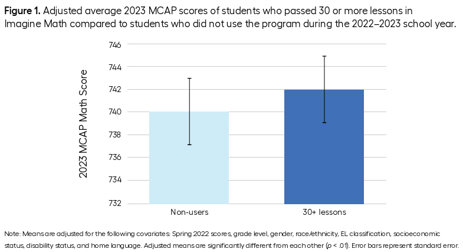

+++
date = '2025-09-19T12:00:46Z'
draft = false
title = "Bar Graphs Should Start at 0"
+++

I was reading an evaluation of a digital learning platform (Imagine Math) the other day, and I came across this graph:

The point of this post isn’t to talk about Imagine Math or whether it’s a good product or how teachers should incorporate it into their math instruction. That the evaluation I was reading was about Imagine Math is completely incidental. Rather, the point of this post is to discuss the sacrilege of creating a bar graph, like the one above, with a y-axis that doesn’t start at 0.

------------------------------------------------------------------------

There are lots of different ways to visually represent data. Points, lines, bars, histograms, density curves, heat maps, shapes, colors, size, etc. etc. Each aesthetic we use to represent data communicates something about the data, either implicitly or explicitly. A bar chart communicates that you’re talking about a continuous *amount* of something – maybe apples or dollars or students, but also maybe something more abstract like a movie rating or a level of happiness or a test score. I think bar graphs tend to make more sense as representations of counts of concrete things (like apples or dollars or students) than they do as representations of more abstract concepts, but I don’t think the latter is necessarily wrong.

Regardless, the aesthetics of a bar chart imply that the shaded portion of the bar corresponds to some quantity. And, conversely, that the un-shaded portion corresponds to *not* that quantity. Hence the shading! What it doesn’t imply, at least not to me, is that we ought to extend any shading to regions not shown on the graph. If the count of the quantity starts at 0, then the y-axis of the bar graph start at 0 so the shading can extend to 0.

In the context of the above graph, it’s a strange choice to me to start the y-axis at 732. It feels remarkably arbitrary. I know next to nothing about the MCAP math assessment, but it’s not clear to me why the authors are opting to show only an 8-10 point segment of a test score measured on a ~750 point scale. Essentially we’re zooming in on a segment that represents about 1.5% of the total range of the measurement.

One possibility is that, although the *entire* range of the MCAP is large, the range for the population of students relevant to this study is rather small. That is, let’s assume the graph shows scores for 4th grade students, it’s possible that 4th grade students only typically score between 730 and 750, hence the restricted range of the y-axis. If this is the case, though, using a point to represent a test score estimate is much more appropriate, because a point doesn’t imply continuity with the values below it. And putting error bars around a point estimate to communicate uncertainty is a well-established best practice.

Another possibility is that the authors were trying to over-emphasize the magnitude of a very small (2 point) difference on a rather large (~750 points) scale, and so they manipulated the y-axis in some data visualization sleight-of-hand.

A third possibility is that whatever graphing software the authors used to make the graph defaulted to starting the y-axis at 732 (based on the range of the data) and the authors just went with the default.

Absent any evidence otherwise, I’ll assume that the authors aren’t intentionally being duplicitous, but it’s worth mentioning that changing the y-axis to exaggerate small differences is very much in the low-integrity data visualization playbook.

Regardless of the reasoning behind the choice, using a bar graph that doesn’t start at 0 is always the wrong choice. If you need to begin your y-axis at a non-zero value, use points rather than bars.
