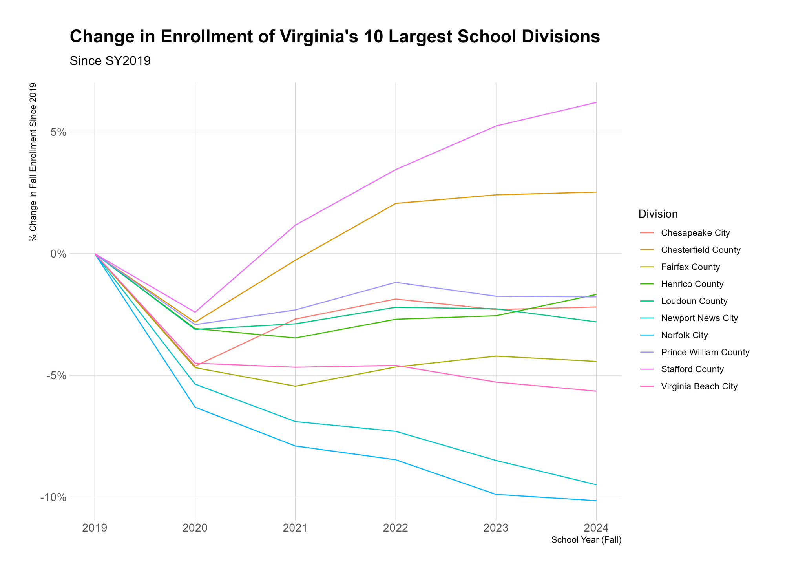
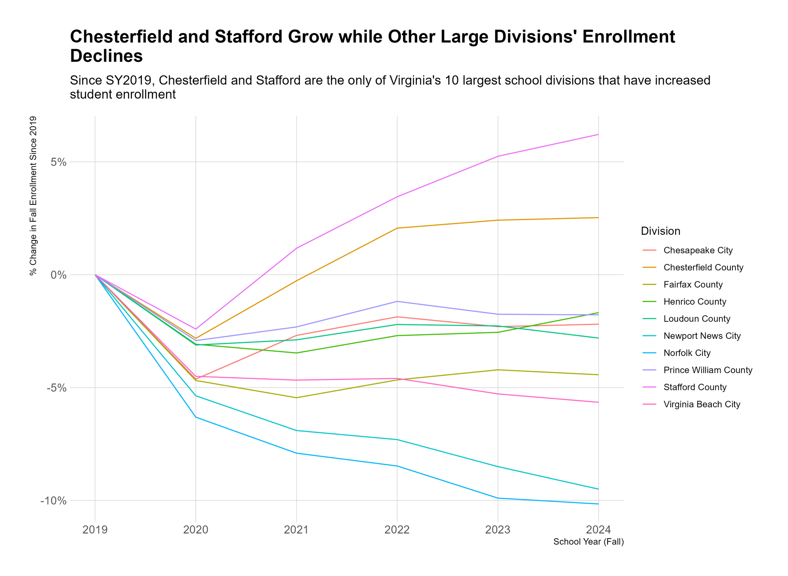
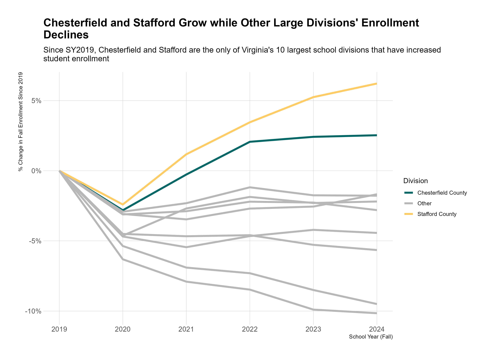

+++
date = '2025-02-07T13:00:16Z'
draft = false
title = "Graphs should be opinionated"
+++

I mentioned in [last week’s post](/edudata/do-less-document-more/) that people often think of quantitative data as objectively true. Not always, but often. And I'll grant that there is something compelling about seeing some phenomenon bundled up into a tidy, concise metric, some little nugget that we can carry around with us and recite with authority.

A corollary of this that I run into often is that the data should “speak for itself.” That the job of any data analyst (or person who’s doing some data analysis task) is to simply get the "objectively true" data in front of decision-makers’ faces so it can whisper its truths to them. There’s a logic to this, I suppose. And in some cases, it’s probably the right way to approach data analysis.

But there are also issues with this perspective. My stance is that data is most useful when it answers a question or tells a story. Humans are social creatures. We react more strongly to – and are better able to remember – stories than we do numbers. So we’re usually better served framing our data as part of a story.

This isn’t to say that we ought to twist statistics to serve some predetermined narrative – if that’s the case, then why bother with the data in the first place. But rather that one of the skills in working with data is essentially a journalistic one – being able to comb through data to identify compelling, actionable stories. In other words, data should be opinionated.

And one of the best ways to make data work opinionated is to make your graphs opinionated.

------------------------------------------------------------------------

To illustrate what I mean, I’m going to work through some data showing change in student enrollment in Virginia’s 10 largest school divisions since the fall of 2019. You can download this data from the Virginia Department of Education’s [Fall Membership Build-a-Table tool](https://p1pe.doe.virginia.gov/apex/f?p=180:1:9560411001269:::::), and you can see all of the code I’ve used to manipulate the data and make the graphs in this [Github repository](https://github.com/ekholme/edudata) (if you’re so inclined). As far as education data goes, student enrollment data pretty benign stuff (although it does determine how much money divisions get!), but it can still serve our purposes here.

There are lots of ways we might approach analyzing this data, but let’s assume we’re interested in looking at the percentage change in enrollment for each of the 10 largest school divisions since 2019. I’m opting for percentage change because it allows for a fairer comparison between divisions, particularly since Fairfax County is gigantic, and so looking at absolute changes in student enrollment would be misleading.

Here’s a baseline version of what this plot might look like:

There’s nothing “wrong” with this. It’s fine. But it’s busy. It’s hard to know what to take away from it. We might notice that all 10 school divisions’ enrollment dropped between 2019 and 2020 (due to COVID). We might notice that some divisions’ enrollment continued to drop even after 2020. We might notice that only 2 divisions have grown since 2019. All of these are viable takeaways.

I’d argue that it’s our job as the people making the graph to know which of these takeaways will be most beneficial for our audience – which will tell the most meaningful story, or inform the most useful decision – and to then create our graph(s) to emphasize this takeaway. And this leads to a few related points:

1.  If there are multiple critical takeaways, you should make multiple graphs. Don't try to jam everything into one mega-graph;
2.  If you’re having a hard time identifying a critical takeaway, maybe the data isn’t that important

But let’s imagine that we think the most important takeaway is that Stafford County and Chesterfield County were the only 2 school divisions (in this group) that grew since 2019. We should tweak our graph to emphasize this.

The most obvious place to start, in my opinion, is with the text. Rather than titling the graph “Change in Enrollment…”, we should just tell people what we want them to get.

This is the same graph, but the title and the subtitle now tell you what the takeaway is. This makes the graph easier to read, because you already know what you’re looking for. You look at the purple and orange lines and you know they’re Stafford and Chesterfield. I suppose you lose the “objectivity” of a generic title, but I don’t consider that a loss.

From here, we kinda know the point we want to make, and so we can continue to refine our graph to make that point more obvious. For instance, we don’t need to include every school division in the legend – we really just need to be able to identify Chesterfield, Stafford, and “other.”

This feels much better. We’re telling a story with this now, rather than hoping our audience can tell themselves a story with the data we’re providing. Yes, by focusing on this story, we are forgoing the opportunity to focus on other stories – for instance, we could have just as easily emphasized the school divisions with nearly 10% decreases in enrollment. But at some point, someone has to decide on a priority, so why punt to someone else?
