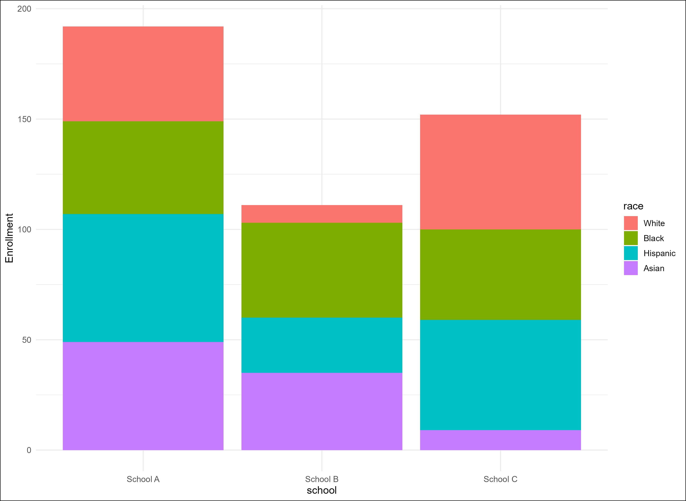
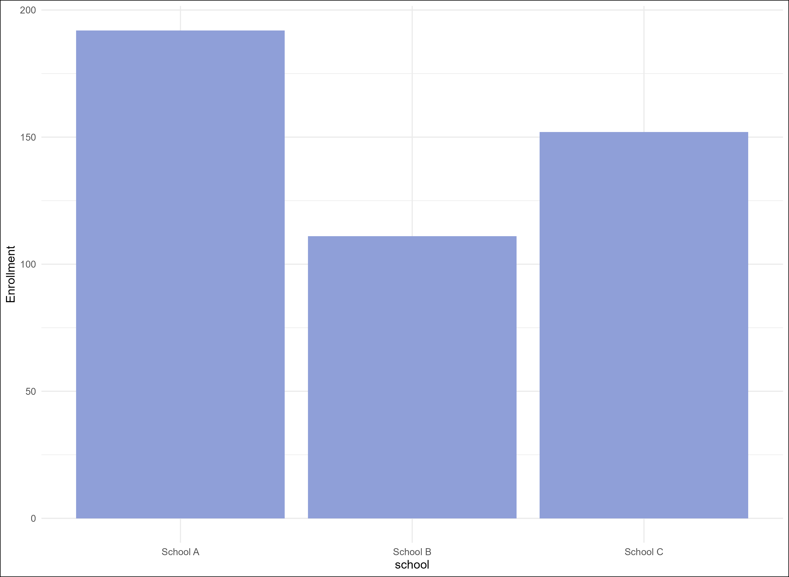
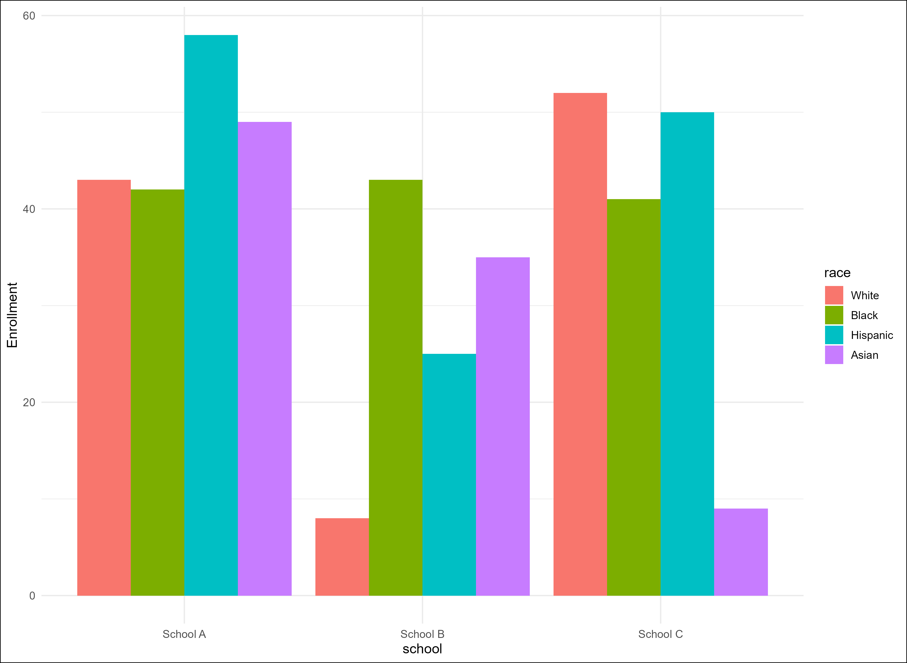
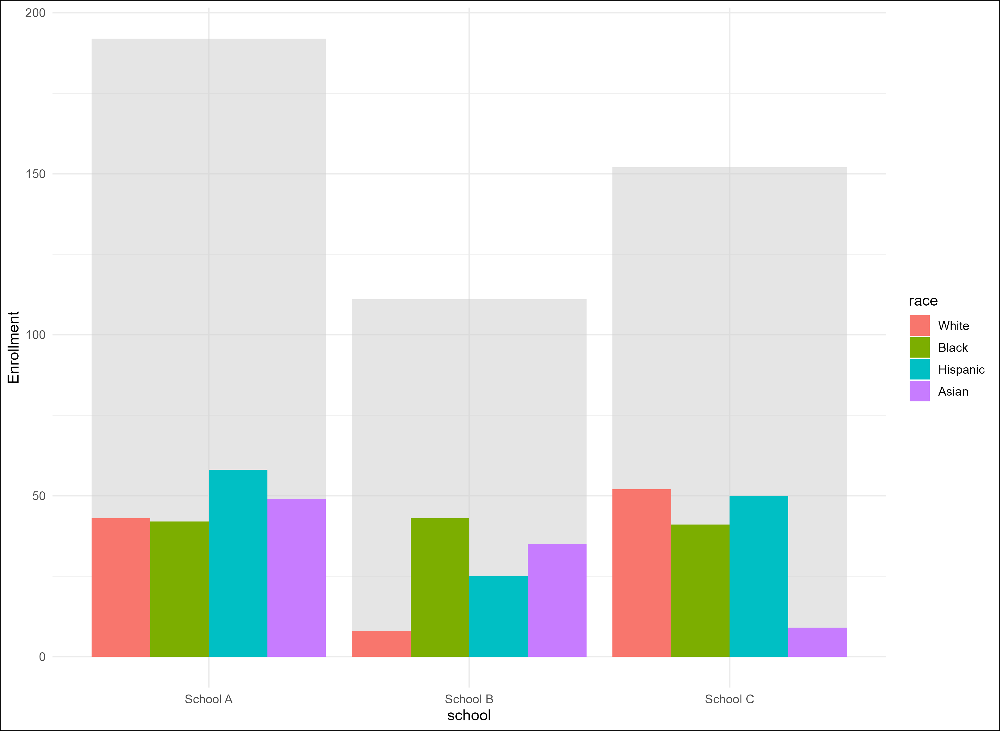

+++
date = '2025-05-16T12:00:09Z'
draft = false
title = "Stacked bar charts and data viz tradeoffs"
+++

Stacked bar charts aren’t good plots, and this is a hill I will die on.

Even though everyone over the age of, say, 7, has seen a stacked bar chart at some point in their lives and probably intuits what they are and how to describe them, I’ll start here with an example and some explicit definitions just to make sure we’re all on the same page.

A stacked bar chart is a plot/graph/chart/what-have-you that lets us visualize some quantitative variable by 2 mutually-exclusive categorical variables. A case I encounter often enough in my job is counting student enrollment (a quantitative variable) by school and by race/ethnicity (our 2 categorical variables). Usually, we think of one of these categorical variables as our group (or primary grouping) variable and the other as a subgroup (or secondary grouping) variable. In this example, we might think of school as our group variable and race as our subgroup variable if we’re interested in counting students by race within each school. We could do the inverse, too, but that feels less obvious to me, at least in this case. 

Here is what a stacked bar chart for this example might look like:

I suspect that people like these graphs – or that they think they like them – for a few reasons. First, they look pretty. This isn’t tongue-in-cheek or ironic. Stacked bar charts, especially ones with bright, vibrant colors, have a certain Wonka-ish appeal to them that just looks cool.

Second, when compared to a grouped bar chart, they require less horizontal space (assuming the quantitative variable is visualized on the y-axis, like in the example above). This isn’t a trivial consideration, especially when you have lots of groups.

Third, and this is probably the main reason why people choose to visualize data as stacked bars, is that they *seemingly* facilitate multiple different comparisons in a relatively compact space. You can compare your total quantitative variable across groups, and you can also compare it across various subgroups, both between and within groups.

Except you can’t really.

The defining feature of a stacked bar chart is, obviously, that it’s stacked. Forgive me for stating the obvious, but this means that only the first subgroup’s section of the graph starts at 0. All of the subsequent subgroup sections start where the previous sections end. This means it’s actually pretty difficult to compare the values for different subgroups across groups, because they’re all starting at different points. For example, in the graph above, it’s not clear (at least to me) whether there are more Black students in School A or in School C because I’m essentially trying to visually compare two lengths that both start and end at different points. It’s akin to having one kindergartener stand on the floor, then having another stand at the top of a flight of steps and trying to determine who’s taller. 

Put slightly differently, we’re trading the ability to do across-subgroup comparisons (the final part of point \# above3) for the horizontal-space-efficiency of point \#2.

The reason I think stacked bars are bad is because, when people make them, they probably *want* to make across-subgroup comparisons but then can’t reasonably do this with these plots. The plots aren’t good at the thing you want them to be good at.

What are some alternatives, then?

It kinda depends on what comparisons you actually care about. If you want to compare the between-group totals (the total height of each bar) *and* you want to compare subgroup values within and across groups, then you probably want two graphs.

The first makes the between-group comparisons clear:

And the second makes the between-subgroup comparisons clear:

For example, in this plot, we can see that School A has slightly more Black students than does School C. We can also see that there are slightly more White students in School A than there are Black students, which wasn’t obvious in the stacked bars version.

If we were really pressed for space and needed to combine everything into a single plot, we could add a “shadow” representing the group totals behind the grouped bars, like this:

But I prefer 2 plots, if it’s possible.

On a more abstract level, I’m realizing that this post isn’t necessarily about stacked bar charts, but rather about trade offs in data visualization. Once we get beyond, like, basic bar charts and scatterplots, everything in data visualization is a trade off. You can generally add more information – more groups, more colors, more shapes, whatever – but it comes at the cost of increased complexity. In a stacked bar chart, we can save space, but it costs us some interpretability. When I’m presenting data to people, I strongly prefer to bias toward simplicity and ease of interpretation where possible. If this means I need 4 different plots to make 4 points, then so be it. I concede that this might not be everyone’s preference in every situation, but it does seem to me like the best starting point.

In other words, start with a grouped bar chart and only use a stacked bar chart if it’s truly the right decision. Which it probably isn’t.
